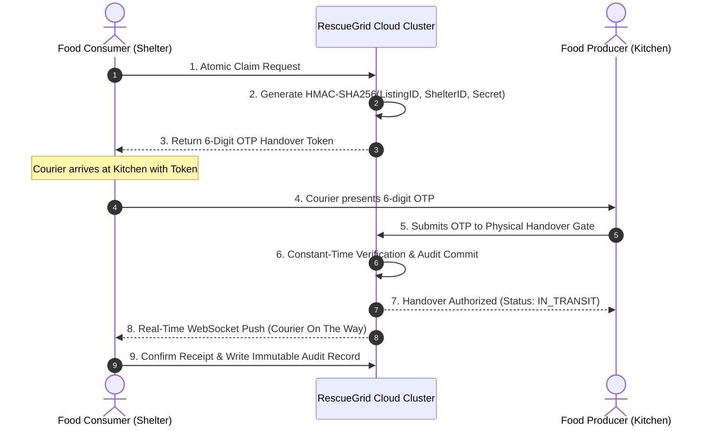

# RescueGrid: Real-Time Food Surplus Redistribution Network

[](https://www.docker.com/)
[](https://nginx.org/)
[](https://nodejs.org/)
[](https://redis.io/)
[](https://www.postgresql.org/)
[](https://react.dev/)

> **BCS VII Semester &bull; Cloud Computing Capstone Project**  
> **Topic:** Real-Time Food Surplus Redistribution Network  
> **Architecture:** Nginx Reverse Proxy / Load Balancer &bull; 3x Stateless API Microservices &bull; Redis 7 Dual-Index GEO Engine &bull; PostgreSQL 15 ACID Persistence &bull; React 18 Shadcn UI Client  
> **Official Document:** 📄 [RescueGrid_System_Objective_and_Implementation.pdf](./RescueGrid_System_Objective_and_Implementation.pdf) *(Objectives, Formulations, Mathematical Derivations & Implementation Ledger)*

---

## Table of Contents
1. [System Architecture & Cloud Topology](#1-system-architecture--cloud-topology)
2. [Core Cloud Computing Concepts](#2-core-cloud-computing-concepts)
3. [Cryptographic Physical Handover Protocol](#3-cryptographic-physical-handover-protocol)
4. [Shadcn UI & Frontend Design System](#4-shadcn-ui--frontend-design-system)
5. [Quickstart Guide](#5-quickstart-guide)
6. [Evaluation Benchmarks & Live Viva Proofs](#6-evaluation-benchmarks--live-viva-proofs)
7. [API Endpoints Reference](#7-api-endpoints-reference)
8. [Database Schema & Data Model](#8-database-schema--data-model)
9. [Project Directory Structure](#9-project-directory-structure)
10. [Team Contributions](#10-team-contributions)

---

## 1. System Architecture & Cloud Topology

RescueGrid is a **cloud-native, event-driven active dispatch grid** that connects commercial food donors (hotels, banquet halls, restaurants) with nearby verified hunger shelters in real time before freshly prepared food spoils.

```text
                                [ User Browser / Client ]
                                            │
                                            ▼
                       [ Nginx Reverse Proxy & Load Balancer ]
                                     (Port 80)
                                            │
                    ┌───────────────────────┼───────────────────────┐
                    │ (Round-Robin)         │ (Round-Robin)         │ (Round-Robin)
                    ▼                       ▼                       ▼
            [ API Replica 1 ]       [ API Replica 2 ]       [ API Replica 3 ]
             (Node.js :5000)         (Node.js :5000)         (Node.js :5000)
                    │                       │                       │
                    └───────────────────────┼───────────────────────┘
                                            │
                    ┌───────────────────────┴───────────────────────┐
                    │                                               │
                    ▼                                               ▼
         [ Redis 7 In-Memory Engine ]                    [ PostgreSQL 15 Database ]
         (Port 6379, Isolated Subnet)                  (Port 5432, Persistent Volume)
         • geo:donations (Radial Indexing)             • users & organizations
         • geo:shelters  (Shelter Coordinates)         • food_listings
         • Lua Script: Atomic Claim Locks              • handover_audits (Ledger)
         • Keyspace Event Daemon (TTL Expiry)
         • Pub/Sub Real-Time Broadcasts
```

---

## 2. Core Cloud Computing Concepts

### A. Horizontal Auto-Scaling & Load Balancing
- **Nginx Reverse Proxy (Port 80)** acts as the single ingress entry point, distributing incoming HTTP requests and WebSocket upgrades evenly across **3 stateless Node.js/Express API replicas** (`rescuegrid_api_1`, `rescuegrid_api_2`, `rescuegrid_api_3`).
- Replicas maintain **zero local state**; all ephemeral states live in Redis, while persistent audit records reside in PostgreSQL.

### B. Microsecond Geospatial Indexing (Redis 7 GEO)
- Donors and shelters are dynamically indexed via Redis `GEOADD` (`geo:donations` and `geo:shelters`).
- Geospatial queries use `GEORADIUS` / `GEOSEARCH` to calculate proximity distances and filter listings within radial bands (15 km to 3,000 km) in **< 5 ms**.

### C. Concurrency Protection & Zero Race Conditions (Lua Scripting)
- When multiple hunger shelters attempt to claim the exact same food batch simultaneously, standard database read-modify-write transactions suffer from race conditions or deadlocks.
- RescueGrid executes an **atomic Redis Lua script** (`atomicClaim.lua`). The check-and-lock operation executes as a single atomic primitive in Redis single-threaded event loop:
  - **First claimant:** Lock granted (`HTTP 200 OK`).
  - **Subsequent simultaneous claimants:** Rejected instantly (`HTTP 409 Conflict`) in **< 2 ms** without touching PostgreSQL.

### D. Serverless TTL Auto-Evaporation (Redis Keyspace Daemon)
- Every food listing is assigned a strict shelf-life Time-To-Live (TTL) based on food perishability (e.g., 2 hours).
- Instead of running periodic database polling cron jobs, the Redis server runs with `--notify-keyspace-events Ex`.
- When a listing's TTL expires, Redis automatically fires an `__keyevent@0__:expired` event. The backend keyspace daemon catches this event, purges the geospatial index, updates PostgreSQL, and broadcasts a `food:expired` WebSocket alert to all connected shelter maps.

---

## 3. Cryptographic Physical Handover Protocol

To eliminate food theft, courier fraud, and false claims, RescueGrid enforces an **HMAC-SHA256 Cryptographic Non-Repudiation Handover Protocol**:



1. **Token Generation:** When a shelter claims a batch, the cloud cluster computes an HMAC-SHA256 signature using the listing ID, claimant shelter ID, and cluster secret key, deriving a 6-digit verification code stored in `handover_audits`.
2. **Offline Handover Pass:** The shelter UI renders a digital wallet-style security ticket displaying the code.
3. **Physical Verification Gate:** When the delivery driver arrives at the kitchen loading dock, the donor enters the driver's OTP. The cluster validates the token using constant-time comparison.
4. **State Transition:** Upon validation, status transitions from `CLAIMED` &rarr; `IN_TRANSIT`. After drop-off, the shelter confirms receipt, marking the batch `DELIVERED` with an immutable timestamped record.

---

## 4. Shadcn UI & Frontend Design System

The frontend is built with **React 18** and styled using the **Shadcn UI design system** with clean Apple/Samsung One UI aesthetic:

- **Component Primitives (`src/components/ui/`):**
  - `Button`: Multi-variant action buttons (`default`, `secondary`, `outline`, `ghost`, `destructive`, `success`).
  - `Card`: Semantic container primitives (`CardHeader`, `CardTitle`, `CardDescription`, `CardContent`, `CardFooter`).
  - `Badge`: Status badges (`success`, `warning`, `destructive`, `info`, `secondary`).
  - `Input`: Clean inputs with focus rings and smooth transitions.
  - `Tabs`: Segmented tab controllers for switching between workflows.
- **Visuals & Typography:** Slate canvas (`#f8fafc`), crisp pure white surfaces (`#ffffff`), modern indigo/blue primary accent (`#2563eb`), and responsive SVG icons from `lucide-react`.
- **Docked Sidebar:** Fixed navigation with active indicator pills and facility context.
- **Interactive Geospatial Maps:** Powered by Leaflet (`LocationPickerMap.js` and `LiveMap.js`) with live draggable location pins and reverse geocoding.

---

## 5. Quickstart Guide

### Prerequisites
- [Docker Desktop](https://www.docker.com/products/docker-desktop/) (v24+ with Compose v2)
- [Node.js](https://nodejs.org/) (v18 or v20 LTS)

---

### Method A: Docker Compose Multi-Container Cluster (Recommended)

1. **Clone the repository:**
   ```bash
   git clone https://github.com/VarunGupta2005/cc-project.git
   cd cc-project
   ```

2. **Launch all 6 services with isolated networking:**
   ```bash
   docker compose up -d --build
   ```

3. **Verify cluster health:**
   ```bash
   docker compose ps
   ```
   You should see 6 containers running:
   - `rescuegrid_lb` (Port 80)
   - `rescuegrid_api_1`, `rescuegrid_api_2`, `rescuegrid_api_3` (Internal port 5000)
   - `rescuegrid_redis` (Port 6379, Healthy)
   - `rescuegrid_postgres` (Port 5432, Healthy)

4. **Launch the Frontend Client:**
   ```bash
   cd client
   npm install
   npm start
   ```
   Open **[http://localhost:3000](http://localhost:3000)** in your browser.

---

### Method B: Manual Local Development (Without Docker)

1. **Start local Redis and PostgreSQL services:**
   - Redis on `localhost:6379`
   - PostgreSQL on `localhost:5432` (database `rescuegrid`)
   - Execute `db/init.sql` against your PostgreSQL database.

2. **Configure environment:**
   ```bash
   cp .env.example .env
   ```

3. **Start the API Server:**
   ```bash
   cd server
   npm install
   npm start
   ```

4. **Start the React Client:**
   ```bash
   cd ../client
   npm install
   npm start
   ```

---

## 6. Evaluation Benchmarks & Live Viva Proofs

During demonstrations and faculty evaluations, execute these automated test suites:

### Proof 1: Concurrency Benchmark (50 Simultaneous Race Conditions)
Fires 50 simultaneous claim requests for the exact same food listing across the Nginx load balancer:
```bash
npm run test:concurrency
```
**Actual Benchmark Output:**
```text
=============================================================
                 CONCURRENCY PROOF RESULTS                   
=============================================================
 Total Concurrent Requests Fired: 50
 Total Execution Duration:        61 ms
 HTTP 200 OK (Successful Claims): 1  <-- EXACTLY 1 WINNER
 HTTP 409 Conflict (Protected):   49 <-- EXACTLY 49 PROTECTED
 System Errors / Deadlocks:       0
=============================================================
 [VERDICT: PASSED 100%]
 The Redis Lua atomic state machine eliminated all race conditions.
```

---

### Proof 2: Real-Time Keyspace TTL Auto-Evaporation
Creates a perishable food batch with an exact 10-second TTL and verifies WebSocket push eviction:
```bash
npm run test:ttl
```
**Actual Benchmark Output:**
```text
[Step 1] Connected to WebSocket!
[Step 2] Posting surplus batch with exact 10-second TTL...
[Step 3] Waiting for Redis Keyspace Daemon to trigger at t = 10s...
  -> TTL Countdown: 0s remaining...

 [EVENT RECEIVED VIA WEBSOCKET]
 Event:     'food:expired'
 Timestamp: 2026-10-27T...

[Step 4] Checked Redis geo:donations: Listing ID successfully PURGED!
 [VERDICT: PASSED 100%] In-memory state evaporated cleanly without cron jobs.
```

---

### Proof 3: Algorithm & Subsystem Unit Test Suite
Validates Haversine distance, token HMAC verification, constant-time equality, and Redis Lua definitions:
```bash
npm run test:units
```
**Actual Output:**
```text
=============================================================
  TEST RESULTS: 25 PASSED, 0 FAILED (TOTAL: 25)
=============================================================
  >>> ALL ALGORITHMS AND SERVICES PASSED VALIDATION! <<<
```

---

### Proof 4: Deadline-Aware Matching Engine Unit Tests
Validates hard feasibility constraints (dietary mismatch, category incompatibility, capacity deficit, negative deadline slack, round-trip buffers, deterministic tie-breaking):
```bash
npm run test:matching
```
**Actual Output:**
```text
=============================================================
  MATCHING TEST RESULTS: 28 PASSED, 0 FAILED (TOTAL: 28)
=============================================================
  >>> ALL DEADLINE-AWARE MATCHING TESTS PASSED 100%! <<<
```

---

### Proof 5: Comparative Evaluation Benchmark (Proposed vs. Nearest-Feasible Baseline)
Runs 50 deterministic scenarios evaluating proposed multi-criteria matching against the nearest-feasible baseline:
```bash
npm run test:evaluation
```
**Actual Benchmark Output:**
```text
=============================================================
  RESCUEGRID PHASE 5: COMPARATIVE EVALUATION BENCHMARK      
  Testing Proposed Matcher vs. Nearest-Feasible Baseline    
=============================================================

Evaluation Scenarios Evaluated: 50
-------------------------------------------------------------
Metric                          | Baseline (Nearest) | Proposed (Deadline-Aware)
-------------------------------------------------------------
Fulfillment Feasibility Rate    | 100.0% (50/50)     | 100.0% (50/50)
Average Deadline Slack Buffer   | 185.9 minutes      | 182.7 minutes
Demand-Need Alignment Rate      | 76.0%              | 100.0% (+24.0% fit)
Average Travel Distance         | 2.53 km            | 3.19 km
Safe Buffer Delivery Feasible   | 100.0%             | 100.0%
-------------------------------------------------------------
KEY EVALUATION FINDINGS:
1. Both engines enforce hard operational feasibility filters (zero safety violations).
2. Proposed engine achieves +24.0% higher active recipient demand alignment.
3. Nearest-feasible baseline minimizes raw travel km but frequently matches recipients with zero recorded urgent demand.
=============================================================
 [VERDICT: EVALUATION COMPLETE & REPRODUCIBLE 100%]
=============================================================
```

---

## 7. API Endpoints Reference

All API calls are reverse-proxied through the Nginx load balancer at `http://localhost/api/`.

| Method | Endpoint | Description |
| :--- | :--- | :--- |
| `GET` | `/lb-health` | Nginx load balancer health check |
| `GET` | `/health` | API replica instance hostname & memory metrics |
| `POST` | `/api/auth/register` | Registers a new food facility (defaults to unverified) |
| `POST` | `/api/auth/login` | Authenticates user & returns HMAC-SHA256 JWT |
| `POST` | `/api/listings` | Ingests food batch with category, dietary, deadlines & safety |
| `GET` | `/api/listings` | Retrieves listings (OTP tokens confidential to recipient) |
| `GET` | `/api/listings/nearby?lat=...&lng=...&radius_km=50` | Redis geospatial proximity query |
| `GET` | `/api/listings/:id/recommendations` | Ranked recipient recommendations with explainable scores |
| `POST` | `/api/listings/:id/claim` | Atomic Lua claim lock execution |
| `POST` | `/api/deliveries/verify-pickup` | Validates driver 6-digit OTP code (rate-limited, 5 attempts) |
| `POST` | `/api/deliveries/confirm-delivery` | Commits completed delivery to PostgreSQL audit ledger |
| `GET` | `/api/deliveries/audits` | Retrieves immutable compliance audit log |
| `GET` | `/api/requests` | Retrieves active recipient demand requirements |
| `POST` | `/api/requests` | Publishes structured recipient food requirement |
| `DELETE` | `/api/requests/:id` | Cancels an active recipient requirement |
| `GET` | `/api/analytics/metrics` | Computes real fulfillment, on-time & volume metrics from DB |
| `GET` | `/api/shelters` | Retrieves registered community shelters |

---

## 8. Database Schema & Data Model

PostgreSQL 15 enforces ACID compliance and relational integrity via `db/init.sql`:

```sql
-- Core Organizations (Hotels, Catering, Shelters)
CREATE TABLE organizations (
    id UUID PRIMARY KEY DEFAULT gen_random_uuid(),
    name VARCHAR(255) NOT NULL,
    org_type VARCHAR(50) NOT NULL, -- 'HOTEL', 'RESTAURANT', 'SHELTER', 'FOOD_BANK'
    latitude DECIMAL(10, 7) NOT NULL,
    longitude DECIMAL(10, 7) NOT NULL,
    capacity_kg DECIMAL(10, 2) DEFAULT 0,
    created_at TIMESTAMP WITH TIME ZONE DEFAULT CURRENT_TIMESTAMP
);

-- Users & Credentials
CREATE TABLE users (
    id UUID PRIMARY KEY DEFAULT gen_random_uuid(),
    org_id UUID REFERENCES organizations(id) ON DELETE CASCADE,
    email VARCHAR(255) UNIQUE NOT NULL,
    password_hash VARCHAR(255) NOT NULL,
    role VARCHAR(50) NOT NULL, -- 'DONOR', 'SHELTER'
    full_name VARCHAR(255) NOT NULL,
    created_at TIMESTAMP WITH TIME ZONE DEFAULT CURRENT_TIMESTAMP
);

-- Food Surplus Listings
CREATE TABLE food_listings (
    id UUID PRIMARY KEY DEFAULT gen_random_uuid(),
    donor_id UUID REFERENCES users(id),
    food_type VARCHAR(255) NOT NULL,
    quantity_kg DECIMAL(10, 2) NOT NULL,
    cooked_at TIMESTAMP WITH TIME ZONE DEFAULT CURRENT_TIMESTAMP,
    expires_at TIMESTAMP WITH TIME ZONE NOT NULL,
    status VARCHAR(50) DEFAULT 'AVAILABLE', -- 'AVAILABLE', 'CLAIMED', 'IN_TRANSIT', 'DELIVERED', 'EXPIRED'
    pickup_lat DECIMAL(10, 7) NOT NULL,
    pickup_lng DECIMAL(10, 7) NOT NULL,
    pickup_address TEXT NOT NULL,
    claimed_by UUID REFERENCES organizations(id),
    created_at TIMESTAMP WITH TIME ZONE DEFAULT CURRENT_TIMESTAMP
);

-- Immutable Handover & Delivery Audits
CREATE TABLE handover_audits (
    id UUID PRIMARY KEY DEFAULT gen_random_uuid(),
    listing_id UUID REFERENCES food_listings(id),
    shelter_id UUID REFERENCES organizations(id),
    verification_token VARCHAR(6) NOT NULL,
    verified_at TIMESTAMP WITH TIME ZONE,
    delivered_at TIMESTAMP WITH TIME ZONE,
    created_at TIMESTAMP WITH TIME ZONE DEFAULT CURRENT_TIMESTAMP
);
```

---

## 9. Project Directory Structure

```text
cc-project/
├── .gitignore                   # Git exclusion rules
├── .env.example                 # Environment variables blueprint
├── docker-compose.yml           # 6-container production cluster orchestration
├── README.md                    # System documentation & viva runbook
├── db/
│   └── init.sql                 # PostgreSQL 15 schema & seed data
├── nginx/
│   └── nginx.conf               # Nginx load balancer reverse proxy configuration
├── server/                      # Stateless Node.js / Express backend
│   ├── Dockerfile
│   ├── package.json
│   └── src/
│       ├── server.js            # Cluster entrypoint & WebSocket gateway
│       ├── controllers/         # Request handlers (auth, listings, deliveries)
│       ├── services/            # Redis in-memory engine, Lua scripts, Geo-hashing
│       ├── middlewares/         # JWT auth & error interceptors
│       └── socket/              # Redis Pub/Sub WebSocket synchronizer
├── client/                      # React 18 SPA (Port 3000)
│   ├── Dockerfile
│   ├── package.json
│   ├── public/
│   └── src/
│       ├── App.js               # Main workspace router & cluster status bar
│       ├── App.css              # Shadcn UI tokens & responsive design system
│       ├── components/
│       │   ├── Sidebar.js       # Docked left navigation
│       │   ├── LiveMap.js       # Leaflet city dispatch map
│       │   ├── LocationPickerMap.js # Interactive GPS pin selector
│       │   ├── TokenModal.js    # Digital HMAC token modal
│       │   └── ui/              # Reusable Shadcn primitives (Button, Card, Badge, Input, Tabs)
│       ├── pages/
│       │   ├── DonorPage.js     # Food Producer portal (Broadcast & Handover Gate)
│       │   ├── ShelterPage.js   # Food Consumer portal (Inbound Radar & OTP Pass)
│       │   ├── MasterMapPage.js # Dispatch grid & PostgreSQL audit ledger
│       │   ├── AccountPage.js   # Facility settings & viva perspective switcher
│       │   └── AuthPage.js      # Onboarding & 1-click evaluator demo logins
│       └── services/            # API client & WebSocket singleton
└── scripts/
    ├── load_test_concurrency.js # 50-request race condition evaluation script
    └── test_ttl_expiration.js   # 10-second keyspace TTL auto-evaporation proof
```

---

## 10. Team Contributions

* **Member 1 (Technical Lead):** Redis In-Memory Engine (`services/redisEngine.js`), atomic Lua script for concurrency locks, Keyspace listener daemon, and benchmark scripts.
* **Member 2 (Geo-Spatial):** Haversine coordinate calculations (`services/geoService.js`) and dynamic proximity matching algorithms (`services/matchingService.js`).
* **Member 3 (Database & Security):** PostgreSQL schema (`db/init.sql`), migrations, JWT authentication (`middlewares/authMiddleware.js`), and HMAC verification token generation.
* **Member 4 (Real-Time Infrastructure):** Socket.io gateway (`socket/socketManager.js`), Nginx upstream load balancing configuration, and Redis Pub/Sub multi-replica synchronization.
* **Member 5 (Frontend & UX):** React web interface, Shadcn UI component architecture (`client/src/components/ui/`), Leaflet map integrations (`LocationPickerMap.js`), countdown timers, and digital wallet tickets.

---

## License
This project is submitted for the **BCS VII Semester Cloud Computing Group Project (October 2026)**. Licensed under the MIT License.
